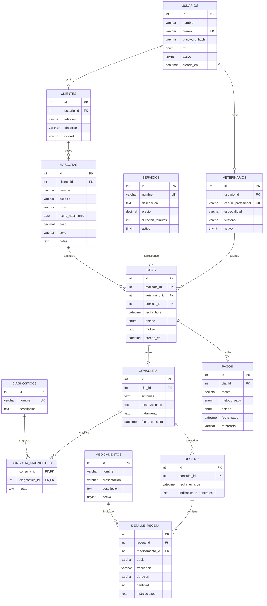

# Veterinaria Huellitas — Primer avance

## Datos del equipo
- 24410214 — Joselyn Contreras Bustillos
- 21410488 — Joel Eduardo Herrera Sánchez
- 24410173 — Omar Ali Loya Reyes

## Descripción
Sistema web para centralizar clientes, mascotas, veterinarios, citas, servicios, consultas, diagnósticos, recetas, medicamentos y pagos. Para este avance se implementa autenticación contra MySQL y pantallas iniciales por rol.

## Cambios respecto a la propuesta
- Se habilitan tres roles de acceso: `administrador`, `cliente` y `veterinario`.
- PHP puro con PDO, HTML, CSS y JavaScript básico; no se usa Apache ni frameworks.
- Para desarrollo local se usa el servidor integrado de PHP (`php -S`). MySQL sigue siendo necesario.
- La conexión se centraliza en `codigo/config/Database.php`; las credenciales se leen de `codigo/.env`.

## Requisitos
- PHP 8.1 o posterior con extensiones PDO y pdo_mysql.
- MySQL 8.0 o compatible.
- PyCharm y Git.

## Instalación en Windows / PyCharm
1. Instala PHP y MySQL y verifica en CMD: `php -v` y `mysql --version`.
2. Abre la carpeta del proyecto en PyCharm.
3. En MySQL ejecuta el script `database/veterinaria_huellitas.sql` (por ejemplo, desde MySQL Workbench o `mysql -u root -p < database/veterinaria_huellitas.sql`).
4. Copia `codigo/.env.example` como `codigo/.env` y configura host, puerto, base, usuario y contraseña de MySQL.
5. Abre CMD/terminal en la carpeta `codigo` y ejecuta: `php -S 127.0.0.1:8000 -t public`.
6. Visita `http://127.0.0.1:8000`.

> El servidor integrado de PHP es para desarrollo/pruebas, no para publicar el sistema en producción. No se requiere Apache para este flujo.

## Usuarios de prueba
La contraseña de las tres cuentas es `Huellitas123*` (cambiarla antes de cualquier despliegue). El script crea hashes con `password_hash` compatibles con PHP.

| Rol | Usuario/correo | Pantalla inicial |
|---|---|---|
| Administrador | admin@huellitas.test | Resumen administrativo y accesos a módulos |
| Cliente | cliente@huellitas.test | Mascotas, citas, historial y pagos |
| Veterinario | veterinario@huellitas.test | Agenda, consultas y pacientes |

## Alcance funcional del primer avance
- Inicio y cierre de sesión con contraseña cifrada y validación en MySQL.
- Redirección por rol y control de acceso en servidor.
- Dashboard diferente por rol, con datos reales de la base.
- Conexión modular con PDO y variables fuera del código fuente.
- Script DDL/DML con 13 tablas relacionadas y datos de prueba.

## Requerimientos funcionales y criterios de aceptación
| ID | Requerimiento funcional | Criterios de aceptación | Validación / excepción |
|---|---|---|---|
| RF-01 | Iniciar sesión | El usuario ingresa correo y contraseña válidos; el sistema consulta MySQL, verifica `password_verify` y abre el dashboard de su rol. | Correo inexistente o contraseña incorrecta muestra mensaje genérico; no se revela cuál dato falló. Campos vacíos se rechazan. |
| RF-02 | Cerrar sesión | Al seleccionar salir se destruye la sesión y vuelve al login. | Una página protegida no debe abrirse sin sesión; redirigir al login. |
| RF-03 | Restringir acceso por rol | Cada rol ve su propia pantalla inicial; las páginas validan rol en servidor. | Si un usuario intenta abrir un dashboard ajeno, se responde con HTTP 403. |
| RF-04 | Administrar clientes (alcance siguiente) | Administrador podrá consultar, registrar, editar y desactivar clientes cuando se implemente el CRUD. | Correo duplicado o campos obligatorios vacíos se rechazan. No se elimina un cliente con historial asociado. |
| RF-05 | Administrar mascotas (alcance siguiente) | Cliente consulta sus mascotas; administrador gestiona los registros. | Mascota debe asociarse a un cliente existente; un cliente no puede consultar mascotas ajenas. |
| RF-06 | Gestionar veterinarios (alcance siguiente) | Administrador consulta y administra perfiles; veterinario accede a su propio perfil. | Correo/licencia duplicados se rechazan; no se asignan citas a veterinarios inactivos. |
| RF-07 | Gestionar servicios (alcance siguiente) | Administrador mantiene catálogo de servicios activos. | Precio no negativo; no se permite reservar servicios inactivos. |
| RF-08 | Gestionar citas (siguiente avance) | Cliente solicita cita; administrador administra agenda; veterinario consulta las citas asignadas. | Fecha pasada, conflicto de horario, mascota ajena o IDs inexistentes se rechazan. |
| RF-09 | Registrar consultas y diagnósticos (siguiente avance) | Veterinario documenta consulta de una cita asignada y relaciona uno o más diagnósticos. | Solo veterinario asignado o administrador autorizado puede registrar; consulta requiere cita existente. |
| RF-10 | Gestionar recetas y medicamentos (siguiente avance) | Veterinario registra receta y sus detalles; cliente consulta las recetas de sus mascotas. | Dosis y cantidad deben ser válidas; no se permiten detalles sin receta o medicamento existente. |
| RF-11 | Registrar pagos (siguiente avance) | Administrador consulta pagos y registra estado/método; cliente consulta solo sus pagos. | Monto mayor que cero; pago asociado a cita existente; transiciones de estado validadas. |
| RF-12 | Generar reportes (siguiente avance) | Solo administrador genera citas, mascotas atendidas, consultas e ingresos por rango de fechas y filtros. Ingresos suma únicamente pagos `Pagado`. | Rango de fechas obligatorio y válido; roles distintos de administrador reciben 403. |

Los RF-04 a RF-12 se documentan como requerimientos del sistema; salvo donde se indica en el alcance, sus CRUD completos no forman parte del prototipo funcional de este primer avance.

## Diagrama entidad-relación


## Conexión a base de datos
La clase `codigo/config/Database.php` carga las variables del archivo `.env` y crea una conexión PDO con excepciones y consultas preparadas. El archivo `.env` está excluido de Git; subir solo `.env.example`.

## Video del primer avance
Pendiente de grabar y publicar. Agregar aquí la URL de YouTube antes de entregar. El video debe durar máximo 10 minutos y demostrar: (1) login válido e inválido contra MySQL, (2) dashboard de Administrador, Cliente y Veterinario, y (3) el archivo `Database.php` y la lectura de `.env`.

## Git y entrega
Los tres integrantes deben realizar commits propios y equilibrados. Después del último commit en `main`, crear y publicar la etiqueta:
```bash
git tag -a v0.1-avance1 -m "Primer avance del proyecto"
git push origin v0.1-avance1
```
Crear el Release `Primer avance del proyecto` asociado a `v0.1-avance1` y entregar la URL del repositorio. No crear el tag hasta que el equipo haya revisado y subido el avance final.
